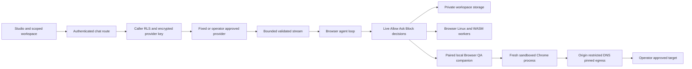

# OpenChat architecture

The existing application is retained: TanStack Start/React, Vite 7, Nitro, Supabase authentication/database/private storage, browser-side tools and isolated workers. The verified `main` checkpoint is `23ed4c4535ebffe7f44c35c7f288a642439c56ad`. Further work lives on `feature/launch-readiness`.

## Boundaries

- Provider secrets are decrypted only in server modules; owner RLS remains active. Compatible APIs do not inherit Gemini request options. Unknown model capabilities are not verification.
- Untrusted chat bodies are byte-bounded and schema-validated. Only neutral user/assistant/tool roles are accepted. Tool definitions have valid names and no duplicates. Reasoning is rendered separately and is not replayed into history.
- SSE parsing bounds frames, supports CRLF/multiline data and fragmented UTF-8, cancels readers on exit and requires an explicit provider terminal event. Interrupted answers remain recoverable instead of being mislabeled complete.
- Navigation/sidebar state remains separate from agent runs. Browser QA session registry keys include owner and workspace; the UI clears old observations when that scope changes.
- Browser QA is an **experimental personal local companion**, not a shared production browser service. Pairing credentials stay in an ignored local file and an in-memory private client field; they are not model/tool inputs or report contents.
- The companion's account/workspace IDs are scope labels supplied by its paired client, not independently verified Supabase claims. The app UI checks workspace ownership through RLS. A future hosted service must verify auth and workspace ownership on the server and issue scoped session credentials.
- Browser processes are never launched from the production app server. The local companion runs outside the app process, launches fresh Chrome with its sandbox enabled and a sanitized environment, and routes network access through a restricted proxy.
- Browser sandboxing, ephemeral contexts and an egress proxy do not constitute a complete hardened multi-tenant container service. Production browser execution still needs OS-level memory/CPU/process quotas, stronger network isolation and independent security review.

## Operational state

`/api/health` is public process liveness. `/api/ready` requires a verified session and reports configuration-only readiness, explicitly without claiming live integration verification. Persistent application state remains in Supabase; local browser evidence is downloadable and agent receipts can use existing conversation attachment persistence.

Cloudflare Browser Run, other cloud browser providers, durable background queues, authenticated browser profiles, arbitrary Playwright scripts, click/fill/submission tools, source repair approval flows and full automated crawling are not implemented by the local read-only slice.
